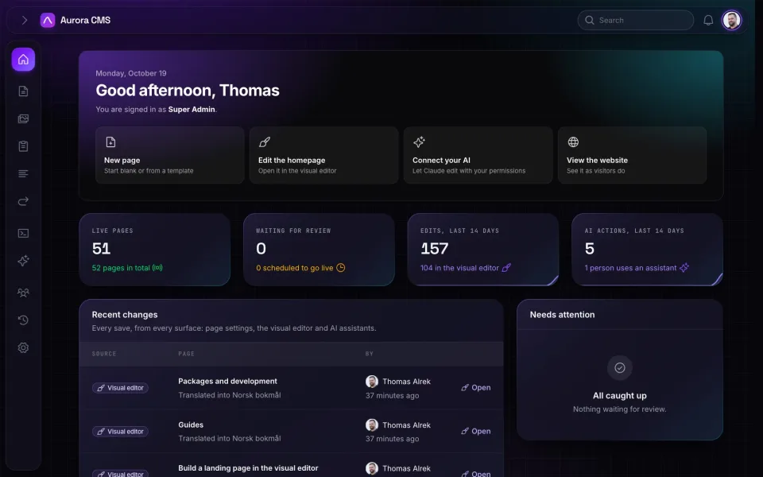

# Borealis

[](https://packagist.org/packages/shipaurora/borealis)
[](https://packagist.org/packages/shipaurora/borealis)
[](https://www.php.net)
[](https://laravel.com)
[](https://filamentphp.com)
[](LICENSE)

The default admin theme for [Aurora](https://shipaurora.com), a content management system for
Laravel built on [Filament](https://filamentphp.com). Deep violet and night blue, with a glowing
sidebar, in light and dark.

<picture>
    <source media="(prefers-color-scheme: light)" srcset="resources/preview-light.webp">
    
</picture>

## Features

- **Light and dark mode.** Everyone picks their own in the user menu, or in the command palette
  (⌘K).
- **The whole admin.** Filament's panels and forms, and Aurora's own screens: the visual editor,
  its inspector, the media library and the settings.
- **Prebuilt.** The stylesheet ships compiled in `resources/dist/theme.css`, so installing it needs
  no build step.
- **A picture of each mode** for Aurora's theme picker, which shows the one the viewer is in.

## Requirements

- PHP 8.3 or newer
- [Aurora](https://github.com/shipaurora/cms) (`shipaurora/cms`), with Filament 5.10 or newer

## Installation

Borealis comes with Aurora: `shipaurora/cms` requires it, and the admin uses it until another
theme is chosen. There's nothing to install.

To add it to an Aurora site that doesn't have it:

```bash
composer require shipaurora/borealis
php artisan filament:assets
```

`filament:assets` copies the stylesheet to `public/css/shipaurora/borealis-theme`. Run it again
after updating the package.

## Usage

Choose the admin's theme under **Settings › Appearance**. The choice applies to everyone who works
in the admin.

To set the theme from configuration instead, until someone chooses one in Settings, set
`AURORA_THEME` in `.env`:

```dotenv
AURORA_THEME=borealis
```

## Making your own theme

A theme is a package that registers itself with Aurora. Borealis' service provider
(`src/ThemeServiceProvider.php`) shows the whole registration, with a picture for each mode.
Aurora's documentation covers writing a theme.

## Development

The compiled stylesheet in `resources/dist/theme.css` is built from the sources in
`resources/css`, which import Filament's theme and Aurora's components. It's built in Aurora's
development setup, where those packages are installed next to it.

## License

Borealis is open-source software licensed under the [MIT license](LICENSE).
